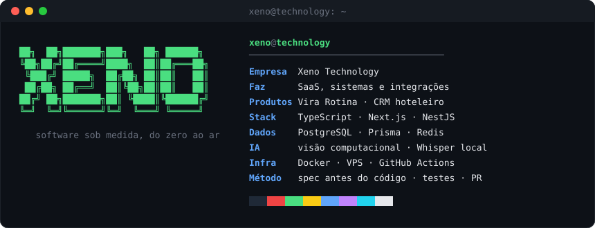
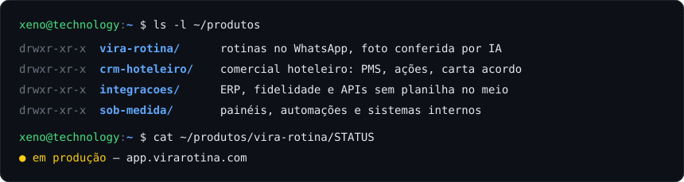

<h3><code>xeno@github ~ $ ./boot.sh</code></h3>

  

<h3><code>xeno@github ~ $ whoami</code></h3>

  

<h3><code>xeno@github ~ $ ls ~/produtos</code></h3>

  

<h3><code>xeno@github ~ $ cat stack.txt</code></h3>

  
  
  
  
  
  
  
  
  
  
  
  

 

<h3><code>xeno@github ~ $ ./contato.sh</code></h3>

  
  

